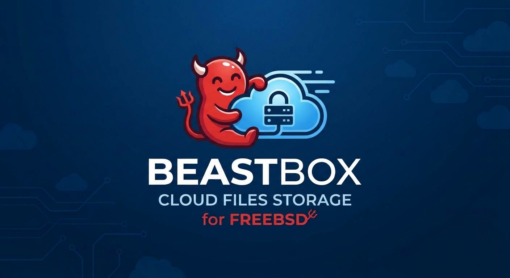

# Beastbox

Self-hosted file server for **FreeBSD**, compatible with the official **Nextcloud** clients, with a web interface and share
links. Built for a family or a small association that wants its files at home, on ZFS, without running a PHP stack.

Security and testing are at the heart of the project, but Beastbox is new and has not been audited by an independent
security firm.

**[Test report](https://modulus.codeberg.page/beastbox/)** of the latest release: tests, coverage, fuzzing, mutation testing, security
rules.

**[Releases](https://codeberg.org/Modulus/beastbox/releases)**: FreeBSD 15 amd64 builds with their SHA-256, and the
release notes.

## Why
I wanted my family's files at home, on the FreeBSD server and ZFS pool I already run, without maintaining a full
Nextcloud (PHP, a database, a long tail of apps). Beastbox keeps files safe and reachable from the Nextcloud apps people
already have on their phones and computers, and not much more.

When goals pull in different directions, not losing a file comes first, then security, then speed and memory use;
new features come last, and many are left out on purpose. The reasoning behind each choice is in the
[specification](docs/dev/beastbox-plan.md).

## What it does
- **Sync with the official clients** — tested for real: desktop client on **Linux** and **Windows**, **Android** app,
  `rclone`. Two-way sync, large files uploaded in chunks, search, favorites, tags, share links. iOS not tested.
- **Web interface** — browse, upload, search, trash, share links; server-rendered, framework-free (55 KB of JS and CSS,
  15 KB compressed).
- **Multi-tenant** — one domain per tenant, several families or associations on the same server.

## Strengths
- **Your files stay files** — one ZFS dataset per user (quota = their space); identity, tags and favorites live in extended
  attributes, not in a database. Backed up with snapshots and restic.
- **No silent loss** — atomic writes (tested with a real `kill -9`), every delete goes through the trash, a conflicting
  write is refused rather than overwritten; backup and total loss tested for real.
- **Security** — tenants isolated on every SQL query and every route, no access outside the dataset (the kernel refuses `..`
  and links), strict CSP, CSRF, argon2id, per-device app passwords, rate limiting, fuzzed parsers, never root.
- **Sandboxed by Capsicum** — once its folders, database and socket are open, the server enters FreeBSD's capability mode:
  the kernel then refuses it any new path, outgoing connection or process. A flaw in the code stays inside what was
  already open: no other file of the machine, no shell; the identity provider is reached only through a Casper channel
  limited to the configured hosts.
- **Small and fast** — a single Rust binary with embedded SQLite, nothing alongside (no PHP, no external database, no cache);
  6 MB of memory at rest, 34 MB under load; 1,000 files listed in 8 ms; search in a few ms over 100,000 files; nothing runs
  when idle.
- **FreeBSD native** — jails, `rc.d`, `pf`, no portability layer; `unsafe` forbidden outside the filesystem module;
  dependencies justified one by one.
- **Tested paranoidly** — unit, end-to-end, property, fuzz and mutation testing on every release, published in the
  [test report](https://modulus.codeberg.page/beastbox/).

## Documentation
- **Use**: [install](docs/admin/installation.md) · [upgrade](docs/admin/upgrade.md) ·
  [back up and restore](docs/admin/backup.md) · [release notes](CHANGELOG.md) · [test report](https://modulus.codeberg.page/beastbox/)
- **Develop**: [specification](docs/dev/beastbox-plan.md) · [testing](docs/dev/TESTING.md) ·
  [attack surface](docs/dev/SURFACE.md) · [validation](docs/dev/VALIDATION.md) · [observed clients](docs/dev/CLIENTS.md) ·
  [dependencies](docs/dev/DEPS.md)

## Develop
```sh
cargo test
cargo clippy --all-targets -- -D warnings
cargo +nightly fuzz run <target>             # propfind, headers, search, proppatch, manifest, query
cargo build --release --locked
```
Testing policy, local CI and release: `docs/dev/TESTING.md`. Working rules: `CLAUDE.md`.

## License
[GNU Affero General Public License](LICENSE), version 3 or (at your option) any later version (`AGPL-3.0-or-later`).
Running a modified Beastbox as a network service means offering its users the modified source.

## Acknowledgements
This software is based in part on the work of the Independent JPEG Group (through `jpeg-encoder`, client thumbnails).
